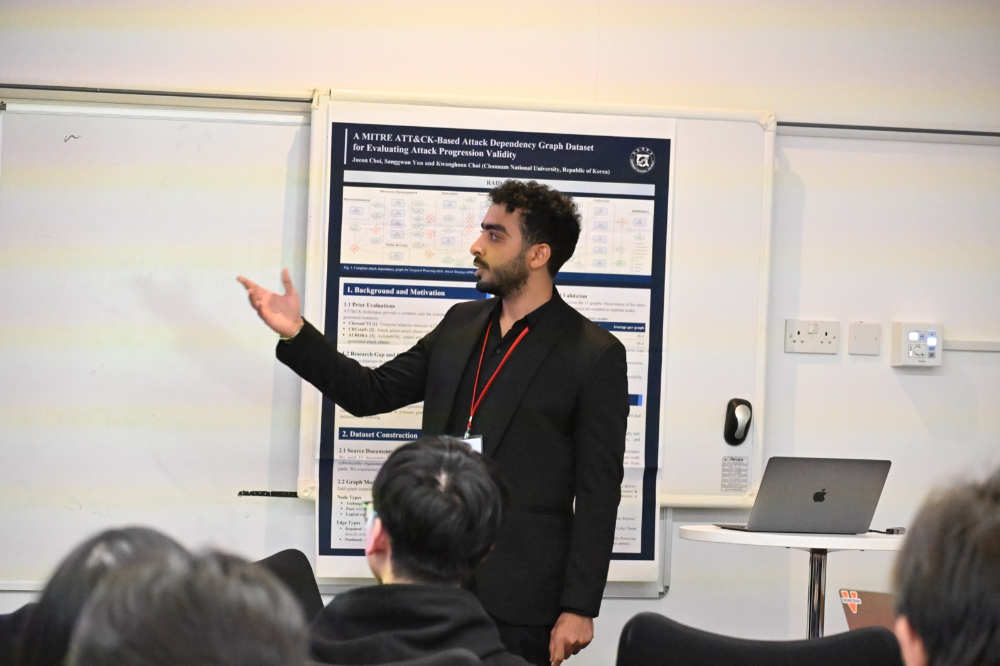

On **13 October 2026**, I presented our paper **[“Small, Free, and Effective: Orchestrating Open-Weight Small Language Models to Outperform Single LLM for Malware Analysis”](/assets/pdf/raid_2026.pdf)** at the **[29th International Symposium on Research in Attacks, Intrusions and Defenses (RAID 2026)](https://raid2026.org/)** in **[Lancaster, United Kingdom](https://www.lancaster.ac.uk/)**, as part of the _Malware Detection & Analysis_ session ([programme](https://raid2026.org/program.html)).

The paper asks whether security teams really need large, costly, closed-source LLMs for malware analysis. We show that a carefully orchestrated team of small, open-weight language models, running locally at **zero API cost**, can match and even outperform a single large LLM, while keeping sensitive samples in-house.

  

Thank you to the session chair, the RAID organisers, and everyone who came along with great questions and discussion afterwards. This work was done with my supervisors [Dr. Budi Arief](https://www.kent.ac.uk/school-of-computing/people/3056/arief-budi) and [Prof. Shujun Li](https://www.hooklee.com/) at the [University of Kent](https://www.kent.ac.uk/).

📄 Read the paper: [Springer (LNCS 17160)](https://doi.org/10.1007/978-3-032-42936-0_3) · [PDF](/assets/pdf/raid_2026.pdf) · [arXiv](https://arxiv.org/abs/2607.20216)
